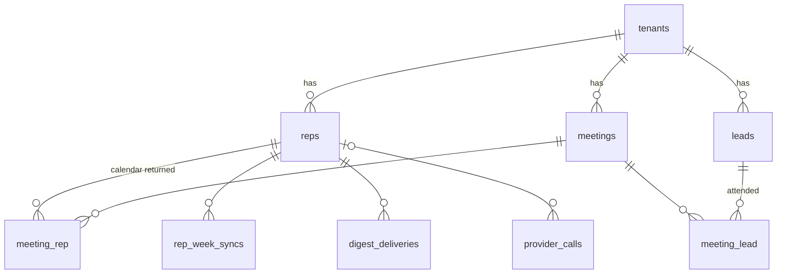
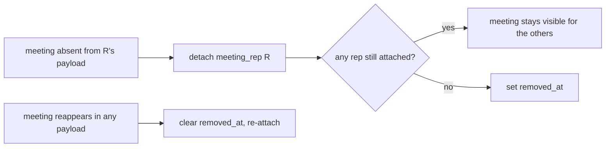
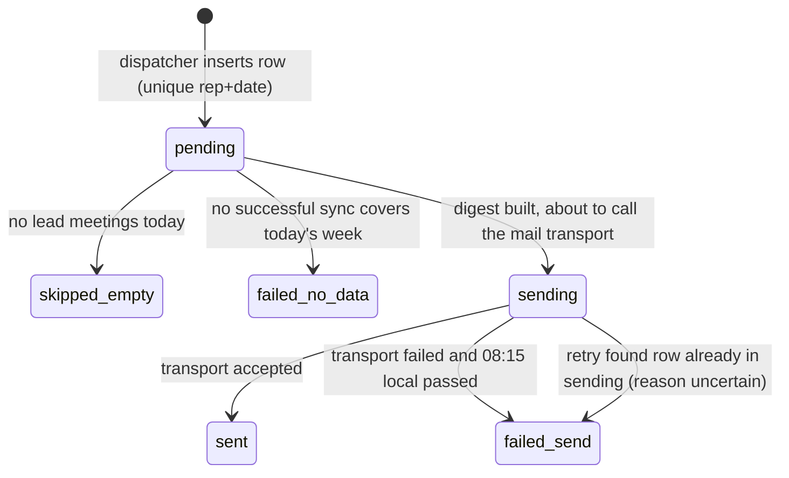

# Data model

All timestamps are UTC. Every table except `tenants` carries `tenant_id` and
is queried through the `TenantScope` (a query with no tenant in context
throws). Identities marked **unique** are database constraints, not conventions.

| Table | Purpose | Identity | Written by |
|---|---|---|---|
| `tenants` | A customer company: name, `internal_domains` (json), `default_timezone`, `provider_credentials` (encrypted with APP_KEY, nullable). | `id` | `tenant:create` |
| `reps` | Sales reps. `email` lower-cased, `timezone` IANA, `active` is the per-rep kill switch, `backfilled_at` marks the one-time backfill. | **unique** (`tenant_id`, `email`) | `rep:add`, `rep:import`, `rep:deactivate`, `BackfillRep` |
| `leads` | External attendees: `email`, `full_name`, `company_name?`, `linkedin_url?`. Profile fields are overwritten by every sync. | **unique** (`tenant_id`, `email`) | `SyncRepWeek` / `BackfillRep` (upsert), `PurgeOldMeetings` (delete orphans) |
| `meetings` | One row per provider meeting per tenant: `external_id`, `title`, `start_at`, `end_at`, `status` (`confirmed`/`tentative`/`cancelled`), `removed_at?`. | **unique** (`tenant_id`, `external_id`); index (`tenant_id`, `start_at`) | Sync jobs (upsert), purge |
| `meeting_rep` | Which reps' calendars returned the meeting. | **unique** (`meeting_id`, `rep_id`) | Sync jobs |
| `meeting_lead` | Which leads attended, with `response_status`. A `declined` link is kept for idempotency but excluded from digests and counts. | **unique** (`meeting_id`, `lead_id`) | Sync jobs |
| `rep_week_syncs` | Per rep and ISO week: `last_success_at`, `last_attempt_at`, `attempts`, `last_error_class`. Drives freshness. | **unique** (`rep_id`, `week_start`) | `SyncRepWeek`, `BackfillRep` |
| `digest_deliveries` | Per rep and local date: `scheduled_for` (08:00 local as UTC), `status`, `failure_reason?`, `sent_at?`, `data_refreshed_at?`, `attempts`. | **unique** (`rep_id`, `local_date`) | `digest:dispatch-due` (insert), `SendDailyDigest` (update) |
| `provider_calls` | Audit of every attempted provider call: `purpose` (`sync`/`backfill`), `outcome` (`success`/`failure`/`timeout`/`rejected_cap`), `duration_ms`, `called_at`. | index (`tenant_id`, `called_at`) | `MeteredCalendarProvider` only |

## Shared-meeting removal rule (PRD FR-5)

A meeting is stored once per tenant and linked to every rep whose calendar
returned it. When rep R's week payload no longer contains a meeting that R was
linked to:

Concurrent syncs of two reps who share a meeting race on the same
`(tenant_id, external_id)`. Writers use `upsert()` (MySQL
`INSERT … ON DUPLICATE KEY UPDATE`) and must pass `tenant_id` explicitly,
because `DB::table()` bypasses Eloquent's `creating` hook.

## Delivery state machine (PRD FR-12)

The insert into `digest_deliveries` happens **before** the job is dispatched,
and only the process whose insert succeeded dispatches. A retry that finds the
row in `sending` does not resend: a lost email is preferred to a duplicate
(ADR-0006).

## Freshness (PRD FR-11)

For a digest on rep-local date *D*, read `rep_week_syncs` for the ISO week
containing *D*:

| `last_success_at` | Meaning | Digest |
|---|---|---|
| null / no row | no data | not sent, `failed_no_data`, alert |
| before *D* 00:00 local | stale | sent with "Meeting data last refreshed at …" |
| on or after *D* 00:00 local | fresh | sent |

## Retention (PRD FR-17)

`meetings:purge` runs daily per tenant: delete meetings with `start_at` older
than `config('digest.retention_days')` (35) days, their pivot rows (cascade),
and then `leads` with no remaining `meeting_lead` row. MySQL rejects
`DELETE … JOIN … LIMIT`, so the purge selects ids in chunks and deletes by id.
